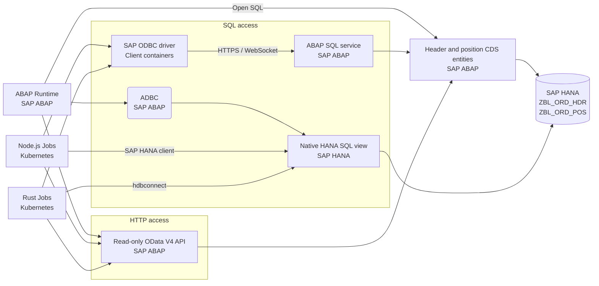

# SAP Off-Stack Case Study

**What performance benefit does each SAP data-access path deliver, and what governance and maintenance obligations accompany it?**

This study compares nine ABAP, Node.js and Rust implementations of one read-only workload. In the recorded experiment, access-path differences were substantial, while the observed runtime gain depended on the path. Rust through CDS combined lower latency with a SAP-managed access boundary. Maintenance implications remain qualitative; timing alone cannot establish the best architecture.[^m1][^j1]

The environment is a local SAP ABAP Trial 2025, client `001`, with custom synthetic orders. This is a comparative experiment, not a proposed production service.

## Experiment in brief

Every successful scan reads the same 5,000 positions from 1,000 order headers, validates nine business fields and strict key order, normalizes exact decimal strings, and incrementally hashes canonical UTF-8 rows. Shared fixtures and count/digest checks test the agreed workload; a matching digest does not establish authorization equivalence.[^c1]

The measured cohort contains three 180-second trials per path, each after five warmup scans. All 27 measured blocks completed, producing 89,189 successful scans. Execution order, versions, inputs and observations are retained with the run. Later correctness and deployment fixes have separate evidence and do not update these historical timings.[^m1]

## Architecture

All paths read the same order tables. ABAP uses HTTP, internal Open SQL over CDS, or ADBC to the native HANA view. Node.js and Rust use HTTP, the ABAP SQL service through ODBC, or native HANA clients. ODBC remains a SAP-mediated route, distinct from a direct database login.[^g1][^s1]

The graph shows available deployment forms. External clients were timed sequentially in Docker; Kubernetes Jobs provide separate deployment checks.

## Performance

**Scan latency in milliseconds: median of three trial p50 values.** Lower is better. CDS means internal Open SQL for ABAP and external ABAP SQL-service/ODBC access for Node.js and Rust.[^m1]

| Runtime | HTTP / OData | CDS | Direct HANA |
| --- | ---: | ---: | ---: |
| ABAP | 1,556 | 76 | 72 |
| Node.js | 1,427.28 | 55.1 | 41.16 |
| Rust | 1,395 | 29 | 16 |

The [full results](docs/nine-comparison.md) include p95, validated-row throughput, every repetition, ranges and latency chronology. Ranges are descriptive, not confidence intervals. Useful throughput includes all measured wall time and repeated validation/hashing work; it is not raw driver retrieval speed or distinct business-document throughput.

## Governance and maintainability

**Rust + CDS preserves SAP-side access control**, as does Node.js through the same ABAP SQL service. SAP controls identity and the exposed service/entities. Business-user access evaluates applicable CDS row controls; privileged access bypasses those row conditions while retaining service/entity authorization. This lab uses privileged access and has no row-level business policy; it does not demonstrate business-user filtering.[^s1][^s2][^g1]

| Access architecture | Governance boundary | Maintenance obligations |
| --- | --- | --- |
| HTTP API over CDS | SAP service contract and configured authorization; HTTP/OData standards do not make a custom API automatically released or stable.[^s4] | API versioning, pagination, client/service compatibility. |
| Internal ABAP CDS | SAP-local model and applicable authorization. | SAP release, activation and package dependencies. |
| External CDS through ODBC | SAP-governed SQL exposure and chosen authorization mode. | Exposed columns, query ownership, certificates and driver compatibility. |
| Native HANA | Database grants and the custom view; ABAP application authorization is not inherited automatically. | Database contract, explicit client filtering and separate policy ownership. |

Both external CDS implementations need the same SAP ODBC driver. Rust adds a compiled build; Node.js uses a native binding. Team familiarity, development speed and long-term support effort were not measured. SAP CAP's Node.js/Java ecosystem explains the Node.js reference choice; this poller is plain Node.js. Rust's native-library boundary still requires care.[^j1][^s3][^s5]

## Five takeaways

1. **Runtime gains depend on the path.** Node.js-to-Rust median latency fell by 2.3% over HTTP and 47.4% through CDS. The difference is more visible in these SQL implementations; its cause needs profiling.[^m2]
2. **Proximity did not determine the result.** External Rust + CDS recorded 29 ms versus 76 ms for internal ABAP + CDS. Runtime, retrieval, conversion and allocation also differ.[^m1]
3. **Governed SQL is a meaningful option.** Rust CDS delivered 29 ms; native HANA saved another 13 ms, about 45%, with a different authorization/ownership model. The benefit must be considered alongside those obligations.[^m2][^g1]
4. **Dependencies matter.** A Node.js cursor-cancellation gap and host memory pressure required investigation, adapter fixes and recovery checks. One incident does not establish a runtime reliability ranking.[^h1]
5. **Equivalent work makes the comparison useful.** Successful scans validate and hash the agreed payload. These checks support the comparison without proving identical policies, query plans or behavior under concurrent writes.[^c1]

## Scope and limits

These are complete-path measurements, not language-only effects. External clients had one-CPU/256-MiB limits; ABAP shared SAP/HANA resources. SQL reused connections across scans; HTTP created a client per scan. Pagination, encryption, identities and placement also differ. The shared host was not isolated, and container-resource sampling was incomplete.[^m1]

Database saturation is not an established bottleneck. Three trials support descriptive findings, not universal rankings or statistical-significance claims. The frozen full-scan workload establishes neither concurrent-write consistency nor lower operating cost. The [extended conclusions](docs/conclusions.md) explain conditional recommendations and optional follow-up experiments.

The external applications are polling consumers; no Rust or Node.js REST façade was implemented or timed.

The author directed design, debugging and validation; AI agents implemented the code. Credentials and SAP driver binaries are excluded.

## Read or reproduce the study

| Goal | Start here |
| --- | --- |
| Inspect the final assessment | [Full results](docs/nine-comparison.md), [measurement protocol](docs/nine-benchmark-protocol.md), [extended conclusions](docs/conclusions.md) |
| Assess the architecture | [Governance and maintainability](docs/system-design-governance.md), [nine application paths](docs/applications.md) |
| Check the supporting claims | [Sources and evidence](docs/sources-and-evidence.md), [archived run](docs/benchmark-data/README.md), [functional contract](docs/implementation-contract.md) |
| Install and run | [Requirements and run guide](docs/requirements-install-run.md), [SAP installation](docs/sap-installation.md), [Kubernetes deployment](deploy/README.md) |
| Explore the implementation | [ABAP](sap/README.md), [Node.js](clients/node/README.md), [Rust](clients/rust/README.md), [supported commands](scripts/README.md) |

The repository retains the final nine-path assessment and its evidence. Client
implementations are in `clients/`, SAP objects in `sap/`, shared behavior in
`contracts/`, deployment files in `deploy/`, and final build/run/verification
tools in `scripts/`. Local credentials, drivers and working results stay in
ignored directories.

[^m1]: [M1: recorded performance](https://github.com/salvatore-amoroso/SAP-Off-Stack-Case-Study/blob/main/docs/sources-and-evidence.md#m1-recorded-performance).
[^m2]: [M2: derived comparisons](https://github.com/salvatore-amoroso/SAP-Off-Stack-Case-Study/blob/main/docs/sources-and-evidence.md#m2-derived-comparisons).
[^c1]: [C1: workload parity](https://github.com/salvatore-amoroso/SAP-Off-Stack-Case-Study/blob/main/docs/sources-and-evidence.md#c1-workload-parity).
[^g1]: [G1: CDS access configuration](https://github.com/salvatore-amoroso/SAP-Off-Stack-Case-Study/blob/main/docs/sources-and-evidence.md#g1-cds-access).
[^j1]: [J1: maintenance obligations](https://github.com/salvatore-amoroso/SAP-Off-Stack-Case-Study/blob/main/docs/sources-and-evidence.md#j1-maintenance-obligations).
[^h1]: [H1: driver investigation](https://github.com/salvatore-amoroso/SAP-Off-Stack-Case-Study/blob/main/docs/sources-and-evidence.md#h1-driver-incident).
[^s1]: [S1: SAP SQL-service exposure](https://github.com/salvatore-amoroso/SAP-Off-Stack-Case-Study/blob/main/docs/sources-and-evidence.md#s1-sql-service-exposure).
[^s2]: [S2: SAP access scenarios](https://github.com/salvatore-amoroso/SAP-Off-Stack-Case-Study/blob/main/docs/sources-and-evidence.md#s2-sql-access-scenarios).
[^s3]: [S3: CAP runtime context](https://github.com/salvatore-amoroso/SAP-Off-Stack-Case-Study/blob/main/docs/sources-and-evidence.md#s3-cap-runtime-context).
[^s4]: [S4: HTTP and OData](https://github.com/salvatore-amoroso/SAP-Off-Stack-Case-Study/blob/main/docs/sources-and-evidence.md#s4-http-odata).
[^s5]: [S5: Rust FFI](https://github.com/salvatore-amoroso/SAP-Off-Stack-Case-Study/blob/main/docs/sources-and-evidence.md#s5-rust-ffi).
