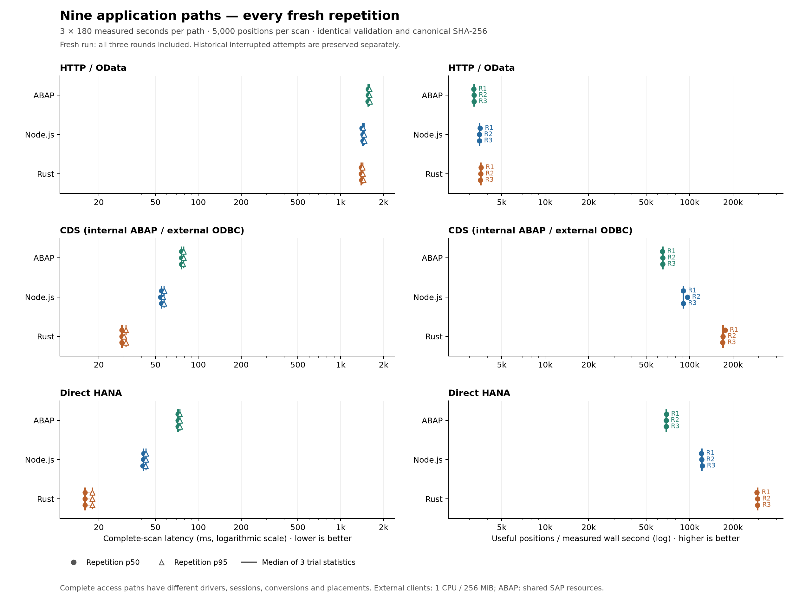
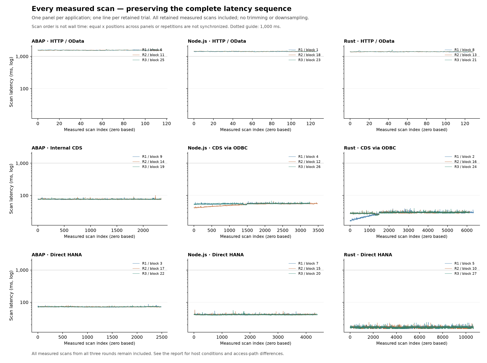

# Nine-application performance comparison

This chapter supplies the **performance** axis. The [design chapter](system-design-governance.md)
and [conclusions](conclusions.md) assess **governance / maintainability** separately.
Rust/Node.js CDS access remains mediated by SAP's SQL service; the recorded
privileged mode and its authorization limits are [explicitly documented](system-design-governance.md#authorization-is-part-of-the-design).
Timing results do not establish authorization equivalence or maintenance cost.

Run: `nine-2026-10-23T21-21-52-459Z`. **All 27 measured blocks completed: three 180-second trials per application.** This is a fresh comparison; previous interrupted or excluded measurements do not enter its statistics.

Every successful warmup and measured scan returned 5,000 rows and canonical SHA-256 `df57de597e919adb10ae5365201b999788e86b39219ad040ffbc305539180bc7`. The measured blocks contain 89,189 successful scans and 445,945,000 repeated row validations of the same 5,000 distinct positions.

## Results

Values are medians of three trial statistics, with observed minimum–maximum in parentheses. Within a trial, p50 and p95 use nearest rank. Ranges are not confidence intervals.

| Application path | Measured scans | p50 ms, median (range) | p95 ms, median (range) | Useful rows/s, median (range) | Measured failures |
| --- | ---: | ---: | ---: | ---: | ---: |
| ABAP · HTTP / OData | 348 | 1,556 (1,552–1,559) | 1,591 (1,590–1,597) | 3,217.82 (3,201.48–3,218.54) | 0 |
| Node.js · HTTP / OData | 382 | 1,427.28 (1,404.37–1,430.08) | 1,459.7 (1,437.07–1,463.09) | 3,504.26 (3,501.79–3,550.23) | 0 |
| Rust · HTTP / OData | 389 | 1,395 (1,394–1,401) | 1,425 (1,418–1,440) | 3,584.35 (3,560.92–3,594.06) | 0 |
| ABAP · CDS | 7,028 | 76 (76–76) | 79 (78–79) | 65,040.74 (65,001.42–65,136.36) | 0 |
| Node.js · CDS | 10,003 | 55.1 (54.14–55.15) | 57.43 (56.59–57.51) | 90,657.64 (90,580.2–96,586.88) | 0 |
| Rust · CDS | 18,595 | 29 (29–29) | 31 (30–31) | 170,505.99 (169,848.84–176,126.17) | 0 |
| ABAP · Direct HANA | 7,450 | 72 (72–72) | 74 (74–74) | 68,993.87 (68,758.68–69,156.29) | 0 |
| Node.js · Direct HANA | 13,119 | 41.16 (40.68–41.24) | 42.76 (42.51–42.77) | 121,104.89 (120,913.38–122,363.64) | 0 |
| Rust · Direct HANA | 31,875 | 16 (16–16) | 18 (18–18) | 295,965.65 (293,250–296,171.41) | 0 |

Useful rows/s = successful scans × 5,000 / actual measured wall seconds. All slow scans and loop overhead remain included; trials have equal weight.

## Observations

HTTP median trial p50 ranges from 1,395 ms (Rust) to 1,556 ms (ABAP).
Rust has the highest observed useful throughput within each access approach;
the gap is much larger for these SQL implementations than for HTTP. These are
descriptive results for the complete implementations, not a controlled estimate
of language-only effects or statistical significance.

The earlier sustained ABAP CDS slowdown after scan 1,389 did **not recur**:
all three current CDS trials continued beyond that point, and their maximum
scan latencies were 89, 101 and 87 ms. This observation does not identify the
cause of the historical slowdown. All three patched Node.js CDS trials also
completed, including slot 26.

## Every repetition

| Slot | Round | Application path | Scans | Actual wall s | p50 ms | p95 ms | Useful rows/s | Max ms |
| --- | ---: | --- | ---: | ---: | ---: | ---: | ---: | ---: |
| 1 | 1 | Node.js · HTTP / OData | 128 | 180.27 | 1,404.37 | 1,437.07 | 3,550.23 | 1,472.95 |
| 2 | 1 | Rust · CDS | 6,341 | 180.01 | 29 | 31 | 176,126.17 | 40 |
| 3 | 1 | ABAP · Direct HANA | 2,490 | 180.03 | 72 | 74 | 69,156.29 | 87 |
| 4 | 1 | Node.js · CDS | 3,261 | 180.01 | 55.15 | 57.51 | 90,580.2 | 65.57 |
| 5 | 1 | Rust · Direct HANA | 10,557 | 180 | 16 | 18 | 293,250 | 24 |
| 6 | 1 | ABAP · HTTP / OData | 116 | 181.17 | 1,559 | 1,591 | 3,201.48 | 1,601 |
| 7 | 1 | Node.js · Direct HANA | 4,353 | 180 | 41.24 | 42.77 | 120,913.38 | 55 |
| 8 | 1 | Rust · HTTP / OData | 130 | 180.85 | 1,395 | 1,418 | 3,594.06 | 1,430 |
| 9 | 1 | ABAP · CDS | 2,341 | 180.07 | 76 | 79 | 65,001.42 | 89 |
| 10 | 2 | Rust · Direct HANA | 10,655 | 180 | 16 | 18 | 295,965.65 | 24 |
| 11 | 2 | ABAP · HTTP / OData | 116 | 180.21 | 1,556 | 1,590 | 3,218.54 | 1,602 |
| 12 | 2 | Node.js · CDS | 3,478 | 180.05 | 54.14 | 56.59 | 96,586.88 | 66.61 |
| 13 | 2 | Rust · HTTP / OData | 130 | 181.34 | 1,394 | 1,425 | 3,584.35 | 1,436 |
| 14 | 2 | ABAP · CDS | 2,345 | 180.01 | 76 | 79 | 65,136.36 | 101 |
| 15 | 2 | Node.js · Direct HANA | 4,360 | 180.01 | 41.16 | 42.76 | 121,104.89 | 58.17 |
| 16 | 2 | Rust · CDS | 6,139 | 180.02 | 29 | 30 | 170,505.99 | 37 |
| 17 | 2 | ABAP · Direct HANA | 2,476 | 180.05 | 72 | 74 | 68,758.68 | 81 |
| 18 | 2 | Node.js · HTTP / OData | 127 | 181.21 | 1,430.08 | 1,459.7 | 3,504.26 | 1,474.98 |
| 19 | 3 | ABAP · CDS | 2,342 | 180.04 | 76 | 78 | 65,040.74 | 87 |
| 20 | 3 | Node.js · Direct HANA | 4,406 | 180.04 | 40.68 | 42.51 | 122,363.64 | 56.12 |
| 21 | 3 | Rust · HTTP / OData | 129 | 181.13 | 1,401 | 1,440 | 3,560.92 | 1,593 |
| 22 | 3 | ABAP · Direct HANA | 2,484 | 180.02 | 72 | 74 | 68,993.87 | 81 |
| 23 | 3 | Node.js · HTTP / OData | 127 | 181.34 | 1,427.28 | 1,463.09 | 3,501.79 | 1,478.46 |
| 24 | 3 | Rust · CDS | 6,115 | 180.01 | 29 | 31 | 169,848.84 | 40 |
| 25 | 3 | ABAP · HTTP / OData | 116 | 180.25 | 1,552 | 1,597 | 3,217.82 | 1,731 |
| 26 | 3 | Node.js · CDS | 3,264 | 180.02 | 55.1 | 57.43 | 90,657.64 | 68.29 |
| 27 | 3 | Rust · Direct HANA | 10,663 | 180.01 | 16 | 18 | 296,171.41 | 24 |

## Complete latency chronology

All measured scans remain included, in their exact within-block order. Equal scan indices across paths do not represent equal wall times. The descriptive threshold max(3 ms, 3 × block p10) identifies variation without establishing its cause.

| Slot | Application | Relative threshold ms | Scans above relative threshold | >1 s segments: first–last measured index (count) |
| --- | --- | ---: | ---: | --- |
| 1 | Node.js · HTTP / OData | 4,181.11 | 0 | 0–127 (128) |
| 2 | Rust · CDS | 63 | 0 | None |
| 3 | ABAP · Direct HANA | 213 | 0 | None |
| 4 | Node.js · CDS | 159.71 | 0 | None |
| 5 | Rust · Direct HANA | 48 | 0 | None |
| 6 | ABAP · HTTP / OData | 4,626 | 0 | 0–115 (116) |
| 7 | Node.js · Direct HANA | 121.11 | 0 | None |
| 8 | Rust · HTTP / OData | 4,083 | 0 | 0–129 (130) |
| 9 | ABAP · CDS | 225 | 0 | None |
| 10 | Rust · Direct HANA | 48 | 0 | None |
| 11 | ABAP · HTTP / OData | 4,560 | 0 | 0–115 (116) |
| 12 | Node.js · CDS | 132.54 | 0 | None |
| 13 | Rust · HTTP / OData | 4,107 | 0 | 0–129 (130) |
| 14 | ABAP · CDS | 225 | 0 | None |
| 15 | Node.js · Direct HANA | 121.26 | 0 | None |
| 16 | Rust · CDS | 81 | 0 | None |
| 17 | ABAP · Direct HANA | 213 | 0 | None |
| 18 | Node.js · HTTP / OData | 4,177.27 | 0 | 0–126 (127) |
| 19 | ABAP · CDS | 225 | 0 | None |
| 20 | Node.js · Direct HANA | 119.79 | 0 | None |
| 21 | Rust · HTTP / OData | 4,128 | 0 | 0–128 (129) |
| 22 | ABAP · Direct HANA | 213 | 0 | None |
| 23 | Node.js · HTTP / OData | 4,206 | 0 | 0–126 (127) |
| 24 | Rust · CDS | 81 | 0 | None |
| 25 | ABAP · HTTP / OData | 4,551 | 0 | 0–115 (116) |
| 26 | Node.js · CDS | 160.27 | 0 | None |
| 27 | Rust · Direct HANA | 48 | 0 | None |

## Method and limits

Each block completes five warmups and then runs continuously for at least 180 seconds, finishing the last started scan. Only one application runs at a time, with five-second inter-block gaps. Scan timers include retrieval, conversion, validation, incremental hashing and cursor/client cleanup; process startup, warmups, control dispatch, final disconnect and output serialization are excluded.

ABAP and Rust emit integer millisecond scan timings; Node.js retains fractional
milliseconds. Percentile precision should be read in that context. Useful
throughput uses the actual block wall time, rather than the reciprocal of p50.

- This compares complete local access paths. HTTP includes OData/SADL, authentication, sockets and JSON; CDS ODBC includes SQL-service and driver work; native HANA uses another database interface and restricted database identity.
- HTTP constructs and closes a client per scan, reusing connections within that scan. SQL clients keep their connection across scans and open/close a query or cursor per scan. Warmup and final disconnect are outside measured SQL wall time.
- ABAP CDS reads typed values internally and formats them in ABAP. The shared ODBC query projects exact decimal and ISO-date strings in SQL. Native HANA also returns a text projection. Common validation and hashing do not make those conversion costs equal.
- Node.js and Rust have equal one-CPU/256-MiB container caps. ABAP runs inside the shared SAP system with service and database resources; its work process does not have a matching independent cap.
- All applications share one host and SAP/database system, with one measured client active at a time. Balanced ordering reduces systematic drift; it does not remove thermal, caching, background-load or time effects.
- Page/package counters describe application behavior: HTTP 51 responses, internal CDS 50 nonempty packages, SQL 51 fetch attempts including EOF. They are not a measured count of SQL statements or physical database round trips.
- Only three repetitions per application were measured. No statistical winner, isolated language-speed ratio, production capacity or concurrent-write claim follows from this run.
- Credentials and SAP driver binaries are excluded. The [privacy-redacted evidence export](benchmark-data/nine-2026-10-23T21-21-52-459Z/privacy-redaction.json) removes incidental personal metadata; all raw measurement blocks and numerical summaries are unchanged. Published integrity hashes refer to that redacted edition.

The [protocol](nine-benchmark-protocol.md) defines the workload. The [captured driver investigation](benchmark-data/nine-2026-10-23T21-21-52-459Z/sources/docs/node-cds-block26-investigation.md) records the earlier failure and cancellation fix; its measurements are not included in this cohort.

## Evidence

The [machine-readable report](nine-comparison.json) retains every latency, resource sample and trial statistic. Immutable image identities were checked at block boundaries and after completion. 167 source snapshots, archived readiness evidence and all raw block hashes were verified. Raw manifest: `docs/benchmark-data/nine-2026-10-23T21-21-52-459Z/manifest.json` (SHA-256 `101819cf878b18c356c471af4e79f72dd3558cf926b4e35e4d608d84ff98e5ca`). Inputs: `docs/benchmark-data/nine-2026-10-23T21-21-52-459Z/inputs.json` (SHA-256 `f27d7d8f4fdfab36952a6520a9491b5c7085ada3e47694da002073083b68c102`). Resource samples describe the shared host and containers; they are not isolated per-language CPU or RSS measurements.

## Recorded run conditions and post-run checks

Control run: **23 October 2026 at 23:21:53 CEST → 24 October 2026 at 00:47:47 CEST**
(Europe/Zurich), 85.9 minutes including startup, warmups, cooldowns and control work.
Raw timestamps and directory names use UTC.

| Item | Recorded condition |
| --- | --- |
| Host | Intel(R) Core(TM) i7-14700K; 28 logical CPUs; 31.77 GiB visible RAM; Windows 10.0.26200. |
| Docker VM | 16 CPUs; 23.47 GiB usable RAM. |
| External clients | 1 CPU, 256 MiB, one worker; CPU core affinity was not pinned. |
| SAP/ABAP | Existing shared SAP/HANA allocation; no independent matching ABAP cap. |
| Transport | HTTP benchmark uses the same local plain-HTTP URL for all three languages; ODBC uses verified HTTPS/WebSocket; native HANA uses the private database TCP route. |

The readiness field `operator_idle_confirmed` records an operator attestation,
not proof of an isolated host. Shared-host scheduling and resource contention
remain uncontrolled factors in this local experiment.

All 162 within-block host-memory samples were present and above the 2 GiB gate;
sampled free RAM ranged from 5.31 to 8.12 GiB. Eleven of those samples lacked
Docker statistics, so container CPU/memory coverage is incomplete. Their empty
Docker observations remain in the raw evidence; they are not zero resource use.

Read-only [post-run checks](nine-postrun-proof.json) matched six active ABAP/CDS
definitions to archived source after EOL/EOF normalization, the native HANA view
definition, driver hashes, configured identities, and SAP start time/allocation.
The [independent arithmetic/evidence audit](nine-comparison-audit.json) reconciled
all 27 blocks, every latency, reported digest/count, trial/aggregate statistics,
68 exact shared fixtures, nine ABAP Unit methods and archive hashes through a
separate code path. It does not independently recompute row hashes from a
complete raw row trace, because pollers emit scan results rather than every row.

## Evidence navigation

Open the [run manifest](benchmark-data/nine-2026-10-23T21-21-52-459Z/manifest.json) and [recorded inputs](benchmark-data/nine-2026-10-23T21-21-52-459Z/inputs.json) directly; their published hashes identify the redacted edition.
